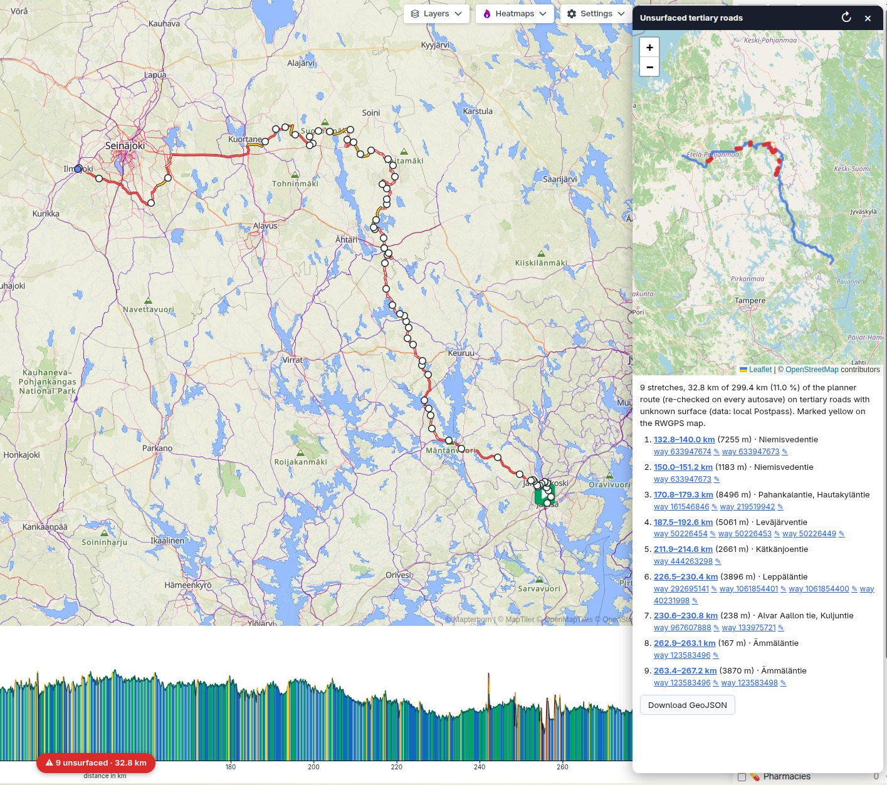

# RWGPS Tertiary Surface Check

A browser extension (Manifest V3, works in Chrome/Chromium/Edge and Firefox) for
RideWithGPS. On a route or trip page it finds the parts of your route that run
on OpenStreetMap `highway=tertiary` roads that have **no `surface` tag**. RideWithGPS
treats those roads as paved, but in many regions (Finland, for example) they are
often gravel.



## Install

**Chrome / Edge / Chromium:** go to `chrome://extensions`, turn on *Developer mode*,
click *Load unpacked* and select this folder.

**Firefox:** go to `about:debugging#/runtime/this-firefox`, click *Load Temporary
Add-on…* and pick `manifest.json`. This lasts until Firefox restarts. To install it
permanently, sign it through AMO or use Developer Edition/Nightly with
`xpinstall.signatures.required=false`.

## Local Postpass server (required)

The plugin gets its OpenStreetMap data only from a local
[Postpass](https://github.com/woodpeck/postpass) instance at
`http://localhost:8081`, which is PostGIS with OpenStreetMap data for Finland. It
doesn't fall back to any public server. If Postpass isn't running, or a route leaves
Finland's bounding box, the check reports an error instead of a result. To use a
different region, change the download URL in `postpass/setup.sh` and
`COVERAGE_BBOX` in `src/content.js`.

```sh
cd postpass
./setup.sh            # first time: download Finland (~770 MB), import it, start the API
./setup.sh --update   # later: fetch a fresh extract and re-import
docker compose stop   # stop it; `docker compose up -d` starts it again
```

The import takes a while and the database uses roughly 15–20 GB of disk (Docker
volume `rwgps-postpass_pgdata`). The setup uses the same schema as the public
`postpass.geofabrik.de`, with these tables:

- `postpass_point`
- `postpass_line`
- `postpass_polygon`

Every table has its tags in a `jsonb` column. You can query it yourself:

```sh
curl http://localhost:8081/interpreter --data-urlencode "options[geojson]=false" \
  --data-urlencode "data=SELECT count(*) FROM postpass_line WHERE tags->>'highway'='tertiary' AND NOT tags ? 'surface'"
```

The API is only exposed on 127.0.0.1, and Postpass connects with a read-only
database user.

## Use

**Route Planner** (`/routes/new`, `/routes/<id>/edit`): checks automatically. Every
time RWGPS autosaves the route you're drawing, the plugin checks it again with local
Postpass, which takes about 0.1 s, and:

- marks flagged stretches **yellow with a dark outline on RWGPS's own map**, on top
  of your route line
- updates the button at the bottom centre to show `⚠ 2 unsurfaced · 1.3 km` or
  `✓ No unsurfaced tertiary`. Click it to open the details panel.

If the route leaves Finland or Postpass is down, the button stays `Surface check`.
Hover over it to see why.

**Saved routes and trips** (`/routes/<id>`, `/trips/<id>`): click **Surface check**
in the bottom-left corner. The stretches are marked on the RWGPS map, and the panel
opens. Clicking a yellow stretch on the RWGPS map opens the panel at that stretch.
(In the planner, a map click adds a route point instead.)

**Details panel:**

- a small map:
  - blue: your route
  - **red**: flagged stretches
  - dashed orange: the full OSM ways those stretches belong to
- a list of stretches, each with its km range along the route, length and road name.
  Click a km range to zoom both maps to that stretch.
- `way …` links that open the OSM way, and ✎, which opens the OSM editor so you can
  add the missing `surface=*` tag
- **↻** to re-check, and **Download GeoJSON** to save the flagged stretches

## How it works

1. Loads the route geometry. On route and trip pages it fetches
   `/<routes|trips>/<id>.json` with your RWGPS session, so private routes work too.
   In the planner it reads the route RWGPS autosaves to the page's localStorage
   (`jStorage` → `locallySavedRoute`). That key is internal to RWGPS, so if they
   change it, planner support breaks until the plugin is updated; saved routes
   keep working.
2. Simplifies the route and fetches `highway=tertiary` ways without a `surface`
   tag near it, using one Postpass SQL query that intersects a 30 m buffer of the
   route.
3. Walks along the route in 10 m steps. A step is flagged when an unsurfaced
   tertiary way is within 15 m **and** runs roughly parallel (within 35°), so
   crossing a tertiary road is not counted. Flagged steps are joined into stretches
   (gaps up to 40 m are bridged, and stretches under 50 m are dropped).
4. Draws the result on RWGPS's map through `src/page-bridge.js`, a script that runs
   in the page's own JavaScript context. It finds RWGPS's MapLibre map object
   through the React component tree, then adds a GeoJSON source and two line layers.
   It re-adds them when you switch map styles and keeps them above the route line.

Tuning knobs:
- `HIGHWAY_TYPES` in `src/content.js`: for example `['tertiary', 'unclassified']`
- `DEFAULTS` in `src/match.js`: distance, angle, gap and minimum length
- `COVERAGE_BBOX` and `QUERY_PAD_M` in `src/content.js`: the area your Postpass data
  covers, and the query corridor width
- `POSTPASS_URL` in `src/background.js`: the Postpass server address

## Limitations

- Drawing on RWGPS's map and reading the planner's autosave both rely on RWGPS
  internals, not public APIs: the React map context and the
  `jStorage`/`locallySavedRoute` localStorage key. A RWGPS update can break them.
  If the map can't be found, the panel says so and still shows its own map.
- Where a route rides the same road twice (out-and-back), the stretches overlap on
  the RWGPS map, so a click selects whichever one is drawn on top.
- Firefox needs version 128 or later, the first with main-world content scripts.
- Results for saved routes are cached for as long as the tab is open. Press **↻** to
  re-query. Planner results are never cached.
- Only routes inside the imported region (Finland) can be checked.
- After changing the manifest (for example when updating from 0.1), reload the
  extension so the new background script and localhost permission take effect.
